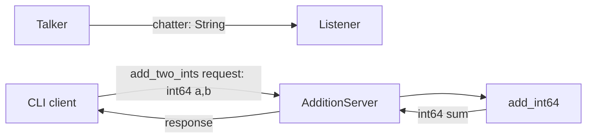

# 结构与接口

```text
Calculator/
  calculator/
    arithmetic.py       int64 范围检查与回绕，不导入 ROS
    cli.py              纯参数解析，不导入 ROS
    publisher.py        定时发布 String
    subscriber.py       接收并记录 String
    service.py          ROS 请求/响应到运算核心的适配
    client.py           异步请求、有限等待、错误退出
  launch/               topics / service / demo 可组合启动
                        multisim 复现官方双 turtlesim 教程
  test/                 核心、CLI、真实 ROS 2 集成测试
  compat/ros1/Calculator 独立 catkin / rostest 兼容包
  scripts/              可重复运行的完整验证入口
  docs/                 要求对照、设计、调试和中英文报告
```

## 数据流



所有运行端点采用相对名称，因此 namespace 与标准 ROS remap 可以正常生效。服务日志显示最终解析后的完整服务名，便于定位命名空间和重映射问题。

独立的 `multisim.launch.py` 保留官方教程的两个命名空间和 turtlesim_node 配置。它不被计算器 demo 自动启动；专门的集成测试会运行该安装文件，验证两组节点、pose 话题、运动控制隔离及官方反向运动命令。

## 运算契约

`validate_int64` 只接受 Python `int`，拒绝 `bool`、浮点、字符串、隐式转换及超出 `[-2^63, 2^63-1]` 的数值。ROS 生成的请求字段也有自己的序列化类型约束。

`add_int64(a, b)` 返回 `(a + b + 2^63) mod 2^64 - 2^63`。标准 AddTwoInts 响应没有错误字段，且不能承载无界 Python 整数，因此明确约定回绕，避免赋值超出消息范围导致回调失败。服务端在溢出时输出 WARN。若业务需要报错而非回绕，应另行设计带状态字段的服务接口；本实现保持标准教程接口不变。

## 生命周期与失败处理

持续节点在 `finally` 中销毁节点并关闭 rclpy；正常 Ctrl+C 不产生无关 traceback。发布器的配置错误会清理部分初始化的节点后抛出清晰异常。周期参数要求有限且大于零，参数在启动后只读。

客户端使用异步 future，不在回调中进行阻塞服务等待。服务发现和响应等待分别有上限；超时移除待处理请求并取消本地 future，不自动重发。服务目前为无状态加法，但明确不重试也使未来扩展更容易推理。网络错误、参数错误与成功的退出码可被脚本识别。

## 测试边界

纯测试验证运算与参数契约；1,000 对固定随机输入使用独立位掩码 oracle。集成测试启动安装后的真实节点，通过 DDS 调用服务和接收话题，同时运行实际安装的 CLI 进程，不用 mock 代替 ROS。

响应超时用例创建一个真实但没有 executor spin 的服务端点：服务可以被发现，回调不执行，因此验证的是等待响应超时。测试使用有限 discovery/spin/subprocess 超时，不依赖固定 sleep。关闭阶段检查持续节点退出码。

ROS 1 兼容包保持独立且较小，避免同时加载 rospy 与 rclpy。两套代码的溢出契约相同，分别以字面边界数据经各自中间件验证。
